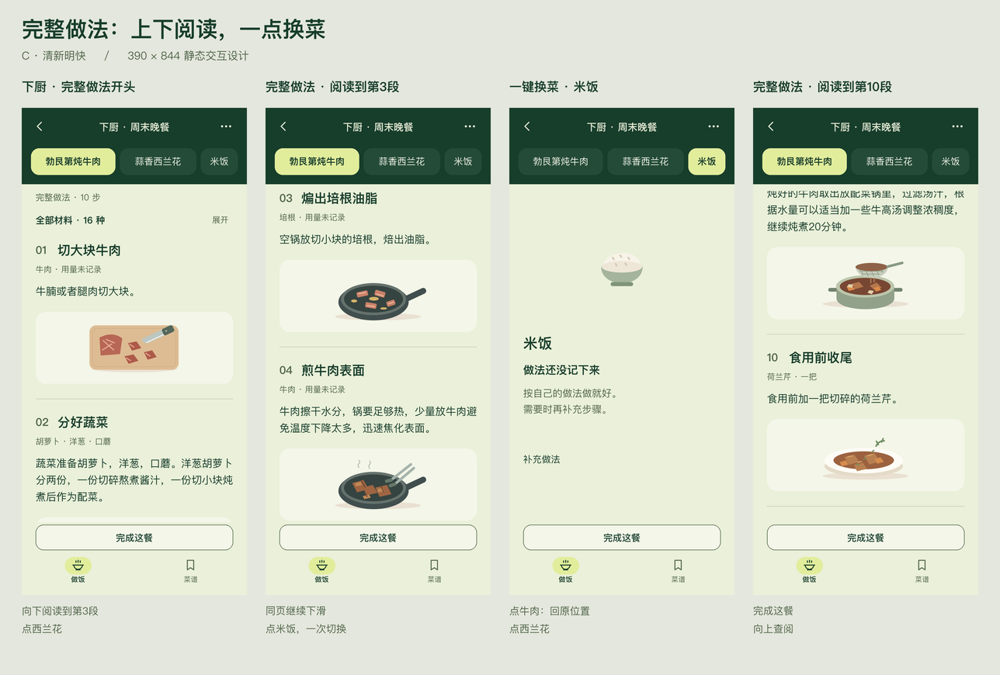
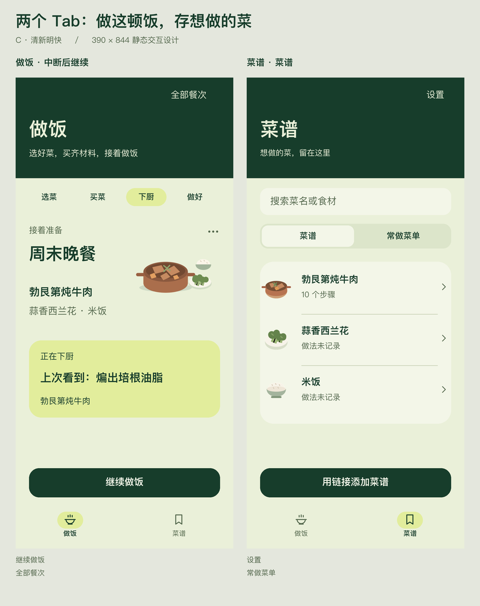

# C 方案逐屏索引

设计日期 2026-10-25；归档日期 2026-11-08。35 个静态状态，1× 和 3× 图均保留。图片原样复制；不等于当前 App 截图。

先读 [当前 PRD](../../prd.md)、[交互规格](../../interaction.md) 和 [视觉 / 差异说明](../README.md)。本地可打开 [HTML 图册](index.html)；在 GitHub 上可直接点击下表 PNG。

## 连续阅读与两栏导航

## 全部状态

| 状态 | 已知边界 | 图片 |
|---|---|---|
| 01-first · 首页 · 第一次打开 | 旧图含阶段条和示例进度卡；当前首页已精简，勿直接恢复这些装饰。 | [1×](screens/01-first-1x.png) · [3×](screens/01-first.png) |
| 02-home-shopping · 做饭 · 买菜中 | 旧图含阶段条和示例进度卡；当前首页已精简，勿直接恢复这些装饰。 | [1×](screens/02-home-shopping-1x.png) · [3×](screens/02-home-shopping.png) |
| 03-home-resume · 做饭 · 中断后继续 | 旧图含阶段条和示例进度卡；当前首页已精简，勿直接恢复这些装饰。 | [1×](screens/03-home-resume-1x.png) · [3×](screens/03-home-resume.png) |
| 04-select · 选菜 · 菜谱 | 静态稿，不证明当前实现或真机验收；参见图稿差异说明。 | [1×](screens/04-select-1x.png) · [3×](screens/04-select.png) |
| 05-select-menu · 选菜 · 常做菜单 | 静态稿，不证明当前实现或真机验收；参见图稿差异说明。 | [1×](screens/05-select-menu-1x.png) · [3×](screens/05-select-menu.png) |
| 06-link · 链接录入 | 图中为底部浮层；两端目前录入容器不同，以交互规格为准。 | [1×](screens/06-link-1x.png) · [3×](screens/06-link.png) |
| 07-link-error · 链接录入 · 保存失败 | 图中为底部浮层；两端目前录入容器不同，以交互规格为准。 | [1×](screens/07-link-error-1x.png) · [3×](screens/07-link-error.png) |
| 08-shopping · 买菜 · 勾选中 | 静态稿，不证明当前实现或真机验收；参见图稿差异说明。 | [1×](screens/08-shopping-1x.png) · [3×](screens/08-shopping.png) |
| 09-shopping-ready · 买菜 · 已备齐 | 静态稿，不证明当前实现或真机验收；参见图稿差异说明。 | [1×](screens/09-shopping-ready-1x.png) · [3×](screens/09-shopping-ready.png) |
| 10-cooking · 下厨 · 完整做法开头 | 静态稿，不证明当前实现或真机验收；参见图稿差异说明。 | [1×](screens/10-cooking-1x.png) · [3×](screens/10-cooking.png) |
| 11-step · 完整做法 · 阅读到第3段 | 同一篇完整做法的阅读位置快照，没有下一步关卡。两端恢复机制不同。 | [1×](screens/11-step-1x.png) · [3×](screens/11-step.png) |
| 12-next · 完整做法 · 阅读到第4段 | 同一篇完整做法的阅读位置快照，没有下一步关卡。两端恢复机制不同。 | [1×](screens/12-next-1x.png) · [3×](screens/12-next.png) |
| 13-last-step · 完整做法 · 阅读到第10段 | 同一篇完整做法的阅读位置快照，没有下一步关卡。两端恢复机制不同。 | [1×](screens/13-last-step-1x.png) · [3×](screens/13-last-step.png) |
| 14-switch · 一键换菜 · 米饭 | 同一篇完整做法的阅读位置快照，没有下一步关卡。两端恢复机制不同。 | [1×](screens/14-switch-1x.png) · [3×](screens/14-switch.png) |
| 15-missing · 一键换菜 · 西兰花 | 静态稿，不证明当前实现或真机验收；参见图稿差异说明。 | [1×](screens/15-missing-1x.png) · [3×](screens/15-missing.png) |
| 16-materials · 完整做法 · 就地展开材料 | 静态稿，不证明当前实现或真机验收；参见图稿差异说明。 | [1×](screens/16-materials-1x.png) · [3×](screens/16-materials.png) |
| 17-complete · 明确完成这餐 | 确认层和成功去向按当前交互规格；图中不是两端现状截图。 | [1×](screens/17-complete-1x.png) · [3×](screens/17-complete.png) |
| 18-complete-error · 完成 · 保存失败 | 确认层和成功去向按当前交互规格；图中不是两端现状截图。 | [1×](screens/18-complete-error-1x.png) · [3×](screens/18-complete-error.png) |
| 19-cancel · 取消这餐 | 确认层和成功去向按当前交互规格；图中不是两端现状截图。 | [1×](screens/19-cancel-1x.png) · [3×](screens/19-cancel.png) |
| 20-plan · 全部餐次 · 待做 | 静态稿，不证明当前实现或真机验收；参见图稿差异说明。 | [1×](screens/20-plan-1x.png) · [3×](screens/20-plan.png) |
| 21-history · 全部餐次 · 做过 | 静态稿，不证明当前实现或真机验收；参见图稿差异说明。 | [1×](screens/21-history-1x.png) · [3×](screens/21-history.png) |
| 22-library · 菜谱 · 菜谱 | 静态稿，不证明当前实现或真机验收；参见图稿差异说明。 | [1×](screens/22-library-1x.png) · [3×](screens/22-library.png) |
| 23-menus · 菜谱 · 常做菜单 | 静态稿，不证明当前实现或真机验收；参见图稿差异说明。 | [1×](screens/23-menus-1x.png) · [3×](screens/23-menus.png) |
| 24-profile · 设置 · 数据备份 | 静态稿，不证明当前实现或真机验收；参见图稿差异说明。 | [1×](screens/24-profile-1x.png) · [3×](screens/24-profile.png) |
| 25-recipe · 菜谱 · 详情 | 原链接在 H5 打开，在小程序复制后查看；没有自动解析。 | [1×](screens/25-recipe-1x.png) · [3×](screens/25-recipe.png) |
| 26-edit · 编辑菜谱 | 旧图带底部 Tab；当前小程序编辑页隐藏 Tab，突出保存。 | [1×](screens/26-edit-1x.png) · [3×](screens/26-edit.png) |
| 27-edit-error · 编辑菜谱 · 保存失败 | 旧图带底部 Tab；当前小程序编辑页隐藏 Tab，突出保存。 | [1×](screens/27-edit-error-1x.png) · [3×](screens/27-edit-error.png) |
| 28-menu-edit · 编辑常做菜单 | 旧图带底部 Tab；当前小程序编辑页隐藏 Tab，突出保存。 | [1×](screens/28-menu-edit-1x.png) · [3×](screens/28-menu-edit.png) |
| 29-restore · 全部餐次 · 已取消 | 静态稿，不证明当前实现或真机验收；参见图稿差异说明。 | [1×](screens/29-restore-1x.png) · [3×](screens/29-restore.png) |
| 30-long-step · 完整做法 · 阅读到第6段 | 同一篇完整做法的阅读位置快照，没有下一步关卡。两端恢复机制不同。 | [1×](screens/30-long-step-1x.png) · [3×](screens/30-long-step.png) |
| 31-adjust · 本餐用料 | 旧图带底部 Tab；当前小程序编辑页隐藏 Tab，突出保存。 | [1×](screens/31-adjust-1x.png) · [3×](screens/31-adjust.png) |
| 32-adjust-error · 本餐用料 · 保存失败 | 旧图带底部 Tab；当前小程序编辑页隐藏 Tab，突出保存。 | [1×](screens/32-adjust-error-1x.png) · [3×](screens/32-adjust-error.png) |
| 33-empty-library · 首次选菜 · 还没有菜谱 | 静态稿，不证明当前实现或真机验收；参见图稿差异说明。 | [1×](screens/33-empty-library-1x.png) · [3×](screens/33-empty-library.png) |
| 34-empty-shopping · 链接菜谱 · 无材料清单 | 静态稿，不证明当前实现或真机验收；参见图稿差异说明。 | [1×](screens/34-empty-shopping-1x.png) · [3×](screens/34-empty-shopping.png) |
| 35-source-recipe · 链接菜谱 · 按原链接做 | 原链接在 H5 打开，在小程序复制后查看；没有自动解析。 | [1×](screens/35-source-recipe-1x.png) · [3×](screens/35-source-recipe.png) |

## 原文与来源

- [牛肉完整做法长图](full-recipe.png) 保留用户提供的10段原文；西兰花与米饭未提供的做法不补写。
- 图片来自旧工作区 `outputs/xiaohongshu-tracks/design-c-2026-10-25/` 的最终 `screens/` 及两栏 / 连续阅读图板；未收录 `before-two-tabs/`、`before-continuous/` 或四栏图板。
- 原文件名 `step`、`next`、`profile` 仅为历史画面编号，不引入逐步翻页或“我的”Tab。
- 菜品 / 步骤插画为既有设计资产，不是用户实拍或视频截帧。原第9 / 10段图曾移除重复标注，以配方正文为准。
- 原始配方来源为用户提供文字及 [原视频链接](https://b23.tv/f09s6Nz)；本次未重新打开或验证视频内容，不把视频解析描述为已有能力。
- [manifest.json](manifest.json) 保存来源文件标识、尺寸与 SHA-256，便于核对归档没有更改图片。
