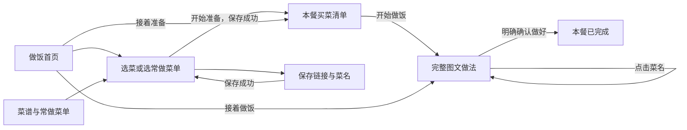

# 煦食 PRD · 当前 MVP

版本：0.1；整理日期：2026-11-08。覆盖 H5 与微信小程序。本文整理已确认的产品方向和业务要求，不因补文档新增功能，也不把代码检查当作真机验收。

## 1. 产品定位

煦食帮助一个人用手机准备家庭的一餐：决定做什么，把已记录的材料整理成清单，下厨时连续看做法，中断后接着做，最后明确结束这一餐。

首要用户是实际买菜、下厨的人，优先服务 iPhone 单人操作。先把自用的一餐做顺，保留周末慢炖、工作日快手菜等不同时间安排，不把所有餐限制为周末或晚餐。它围绕菜谱和餐次组织，采购勾选只是其中一个环节。

**用户目标：看得清、操作顺手、知道下一步、少判断和重复确认。** 产品价值首先是“省事儿”；现有个人反馈不能证明外部需求、营收或普遍节省了多少时间。

## 2. 已确认的取舍

| 用户确认 / 反馈 | 当前产品决定 |
|---|---|
| “现在做饭就我一个，先以我为准吧”“用 iphone” | 一个操作者、手机优先；暂不做多人协作 |
| “没有漏买材料”“没有买错”“省事儿” | 保留采购清单价值；继续通过真实使用验证，不能据此宣称所有用户有效 |
| 常做菜单在收藏已有，首页按钮太多 | 菜谱 Tab 放菜谱 / 常做菜单；安排一餐时也能选菜单，首页聚焦当前餐 |
| 想通过链接简单录入 | 先保存链接与菜名，材料和做法可后补；不暗示已有 AI / 视频解析 |
| “用完整做法” | 一页连续阅读图文，一点换菜；取消逐步“上一步 / 下一步”确认 |
| 已批准底部导航简化 | 两个 Tab：做饭、菜谱；全部餐次和设置作为二级入口 |
| 买齐之后为什么还要核对配方 | 开始做饭不设配方 / 用量核对关卡 |
| 保存后应返回；弹框不应残留 | 成功结束编辑回来源；失败保留输入并允许重试 |
| 不需要“这次谁来吃”、调整口味 | MVP 不提供用餐人、忌口档案、口味画像或厨具管理入口 |
| 西芹虽然不喜欢，但按实际需要保留 | 原配方优先，不按个人偏好自动删除材料 |
| “后续需求变动，两个版本都要改” | 默认一项需求同时交付 H5 与小程序，见 [维护约定](dual-platform.md) |
| “直接写死数据呢，上传备份很麻烦” | 当前试用包内置已确认的 3 道菜谱、2 个测试餐次；无本地记录时自动保存，已有记录（含主动清空后的空库）不覆盖 |

## 3. 信息架构与主流程

| 入口 | 职责 | 子页面 / 分支 |
|---|---|---|
| 做饭 | 安排第一餐、识别当前餐与阶段、接着准备 | 选菜、买菜、完整做法、本餐用料、全部餐次 |
| 菜谱 | 保存想做的菜和可复用组合 | 菜谱 / 常做菜单分段、搜索、添加 / 编辑、菜谱详情、设置与备份 |

已开始做饭后，采购状态变化不应迫使用户重新走选菜或配方核对。阅读、采购、餐次完成是不同状态。平台之间的返回方式和恢复能力见 [交互规格](interaction.md)。

## 4. MVP 功能与验收要求

| ID | 能力 | 必须保留的业务结果 |
|---|---|---|
| P01 | 首页与恢复 | 没有当前餐时给出安排入口；有当前餐时显示餐名、菜品、阶段和继续入口。用户选错或计划变化时可从餐次管理取消，不被锁死在这餐。首页不重复摆常做菜单库。 |
| P02 | 菜谱库 | 按名称 / 材料查找菜谱；查看原材料、原做法和来源。缺少做法时如实展示，不补造步骤。 |
| P03 | 轻量录入 | 链接 + 菜名即可先保存；可选地手动补材料 / 做法。同一规范化来源链接避免重复记录，存在输入差异时不能静默丢掉新输入。 |
| P04 | 安排一餐 | 勾选已有菜谱或使用常做菜单后可增减菜品；餐名 / 日期不是开始准备的强制关卡。保存成功才产生一餐，退回选菜不新增，失败重试不重复新增。 |
| P05 | 买菜清单 | 根据这餐已有材料生成清单，展示原始用量；未知用量明确提示。直接勾选 / 取消，原行不重排、不因反复点击自动跳格；不再增加冗余撤销按钮。 |
| P06 | 缺材料场景 | 只有链接或部分材料时明确说明清单不完整，不显示“0/0 已备齐”误导用户。仍允许看原做法或开始做饭，不强制填满配方。 |
| P07 | 开始下厨 | 一次主操作进入完整做法，不经过本餐详情、下厨总览或额外配方确认。 |
| P08 | 连续图文 | 菜名和本餐上下文清楚；顶部一点换菜。全文按原步骤连续滚动，材料可就地展开。编号用于阅读，不是操作关卡或烹饪完成标记。 |
| P09 | 中断后继续 | 阅读位置按餐次 + 菜谱隔离；切菜、切 Tab、返回后能继续原餐。H5 会话恢复与微信本地恢复的边界明确，不承诺跨设备自动同步。 |
| P10 | 本餐调整 | 材料取舍、原始用量和备注只作用于这餐；完成调整后返回来源。小程序放弃草稿不提交，合并草稿不回滚后来已做的采购勾选；H5当前逐项自动保存，退出不撤销已落盘修改。 |
| P11 | 明确完成 / 取消 | 买齐、看到末段都不自动完成；点击完成并确认才改变餐状态。取消确认不改变状态；写入失败不提前返回或提示成功。 |
| P12 | 餐次与复做 | 查看待做 / 做过 / 已取消；可恢复取消的餐或再做一份独立新餐。复做重置采购，保留需要复用的材料 / 用量；旧餐不被覆盖。 |
| P13 | 常做菜单 | 用户从自己的菜谱勾选组成菜单；可编辑、复用。菜单不是固定套餐，修改菜单不回写已安排的餐。 |
| P14 | 保存与备份 | 保存失败留页保留输入，重试不重复创建。导出、校验后确认导入；无效数据不能清空现有记录；维持 schema v2 与 v1 迁移兼容。 |

这些是当前验收契约，不代表每项已在 iPhone 上通过。代码可证的行为、两端差异和未验证项集中在 [交互规格](interaction.md) 与 [验证记录](validation.md)。

### 当前实现尚未统一的细节

| 对应能力 | 现状与边界 |
|---|---|
| P03 链接录入 | H5和小程序的录入容器、新菜是否自动勾选、重复来源但输入不同时的处理不同；“不静默丢输入”是验收目标，不能将两端现状写成已一致。 |
| P09 恢复 | H5恢复Tab栈及段落锚点；小程序回根页后点继续，主要恢复像素位置。正文或上方布局变化后的精确恢复待验证。 |
| P10 本餐调整 | H5逐项自动保存，小程序点击完成才合并提交。取消 / 退出的含义必须按平台说明，不能承诺H5退出即撤销。 |
| P11 / P12 完成和恢复 | 完成后一端进入做过列表、一端回首页；恢复取消餐的成功去向也不同。业务状态共同要求一致，具体导航见交互表。 |
| P14 导入备份 | H5重置待做餐采购，小程序保留采购；清理草稿和导入前副本机制也不同。当前只证明格式兼容，不承诺两端导入后全部状态相同。 |

本轮只记录这些差异；是否统一及如何统一需要在对应后续需求中明确，不因为归档旧图直接改业务结果。

## 5. 数据对象与内容约束

| 对象 | 用户理解 | 关键边界 |
|---|---|---|
| 菜谱 | 一道菜的原材料、完整做法和来源链接 | 与本餐调整分开；不通过打开链接虚构解析结果 |
| 常做菜单 | 一组可复用的菜谱 / 已保存组合 | 可以增减，不代表已创建一餐 |
| 餐次 | 这一次实际准备与下厨 | 保存本餐材料快照、采购状态、备注；不同餐隔离 |
| 阅读记录 / 草稿 | 上次看到哪里、尚未提交的输入 | 不等于已做完；平台独立存储，不冒充云同步 |
| 备份 | 可手动保存和导入的家庭数据 | 不把所有平台的阅读记录 / 草稿都声称为跨端备份内容 |

原始示例沿用勃艮第炖牛肉、蒜香西兰花、米饭。牛肉保留用户提供的 10 段原文，包括培根和西芹；西兰花、米饭未提供的做法和用量保持缺失。插图是动作示意，不是用户实拍或视频截帧。数量不明不估算，采购量不做无依据的单位相加。

现有旧备份中的用餐人等兼容字段可保留；保留字段不等于恢复对应业务模块。

2026-11-09 试用数据：勃艮第炖牛肉、蒜香西兰花、米饭；餐次为“模拟器验证餐”和“今晚这餐”，当前餐为后者。保留原采购状态和本餐备注，初始化写入失败须提示未保存并可重试。不包含旧阅读位置和未保存草稿；这是随代码携带的固定测试快照，不是云同步。正式对外发布前应重新确认是否保留测试餐次。

## 6. 视觉与交互原则

采用已选定的 **C · 清新明快**：深绿、浅绿、嫩黄绿反馈，系统中文字体。手机 App 的任务层级优先，当前餐、菜名、原文和下一步成为主角。

- 普通业务页面保持做饭 / 菜谱导航；表单编辑场景突出返回与保存，具体平台规则见交互规格。
- 当前屏只有一个最主要动作；已有采购勾选本身可取消，不追加冗余确认。
- 保存 / 完成按钮靠近拇指可达的底部，不再放重复“完成”入口。
- 动效表达选中或切换，不推迟业务操作、不让清单因状态变化自动跳动；支持减少动态效果。
- 图稿的 390 × 844 是设计基线，不能替代键盘、安全区、大字号和 VoiceOver 验收。

图稿、样式数值及已知偏差见 [设计说明](design/README.md) 和 [静态图册](design/c-2026-10-25/index.html)。

## 7. 当前不做

自动提取任意链接 / 视频菜谱、AI 营养评分、自动周计划、外卖下单、多人协作、朋友忌口档案、厨具管理、云同步、账号系统、支付、广告、社区投稿均不属于当前 MVP。健身 / 备餐、旅游和特殊人群饮食作为远期方向保留，不据此增加当前页面和入口。

## 8. 验收与后续演进

每项需求默认双端实现：先写操作与预期结果，运行两端回归，再分别记录浏览器、微信模拟器和 iPhone 真机检查。使用 [操作脚本](../miniprogram/ACCEPTANCE.md) 验证采购、连续阅读、恢复、失败重试和明确完成；不能以自动化数量代替使用效果。

下一次真实做饭重点记录：是否漏买 / 买错、是否需要重复确认、切换后能否找回原菜原文、保存失败是否丢输入，以及使用者是否愿意下次继续使用。尚未建立足够样本，不公布节省时间或付费转化数字。

未来方向、进入条件和被替代的方案见 [迭代规划](roadmap.md)。修改需求时同步更新 PRD、交互规格、受影响设计说明和两端实现；旧图不直接覆盖当前契约。
